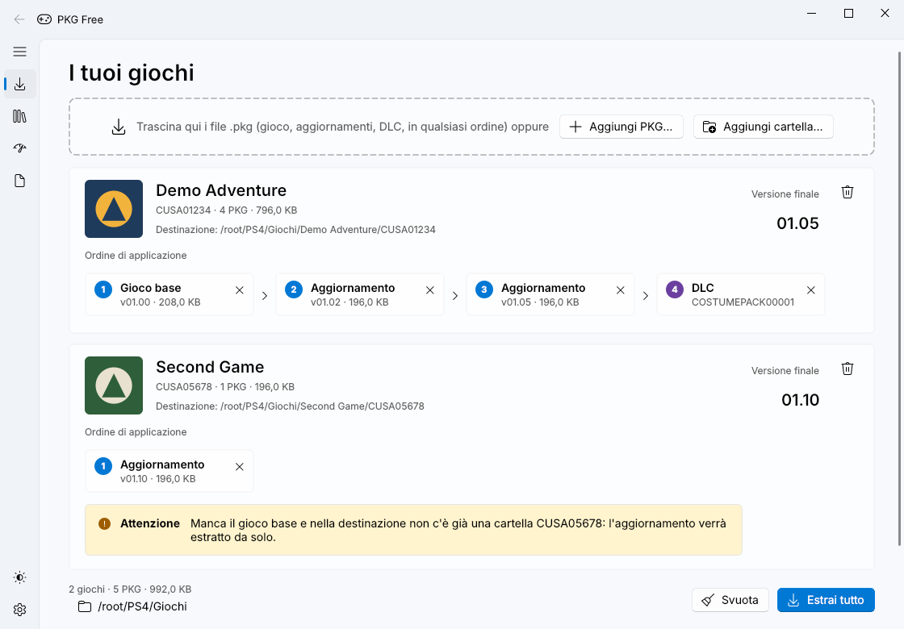
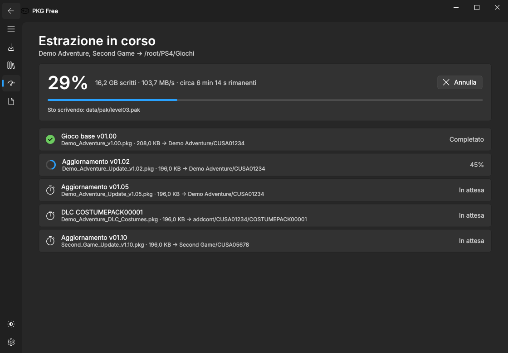
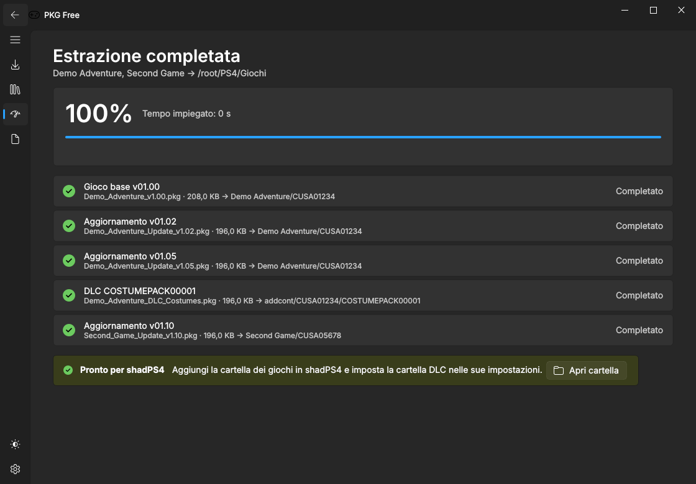
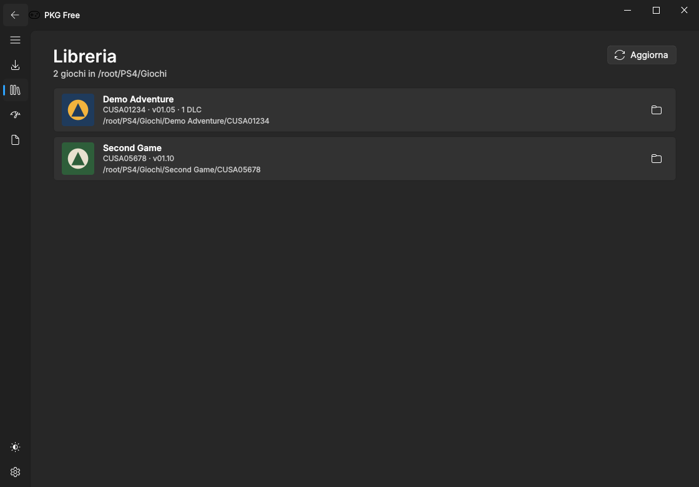
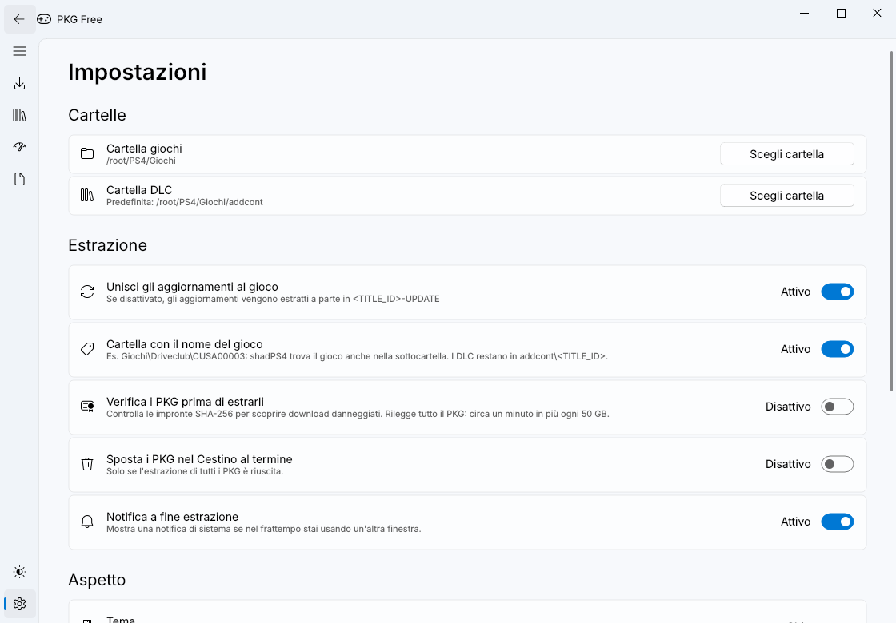

# PKG Free

Programma per Windows, Linux e macOS che estrae i file **PKG PS4** in una cartella pronta per
l'emulatore [shadPS4](https://github.com/shadps4-emu/shadPS4), unendo
**gioco base + aggiornamenti (patch)** in un'unica cartella aggiornata e
sistemando i **DLC** nella struttura che shadPS4 si aspetta.

> Sono supportati solo i PKG **"fake" (fPKG)**: backup dei propri giochi e
> homebrew firmati con le chiavi di debug pubbliche. I PKG retail scaricati dal
> PlayStation Store sono cifrati con chiavi della console e **non** possono
> essere estratti. Usa il programma solo con contenuti di cui possiedi i diritti.



## Download

Le versioni pubblicate si trovano nella pagina **Releases**. Ogni push compila
anche gli eseguibili con GitHub Actions (scheda **Actions** → ultima esecuzione
di *Build* → artefatti). Creando un tag `v*` (es. `v1.2.0`) viene pubblicata
una release con un file per ogni sistema. In alternativa, senza creare il tag a mano: **Actions → Build →
Run workflow**, scrivendo la versione (es. `v1.2.0`) nel campo del tag; deve
corrispondere a `__version__` in `pkgfree/__init__.py`. La descrizione della release è la
sezione `## vX.Y.Z` di [`CHANGELOG.md`](CHANGELOG.md), che va scritta prima. Per correggere
la descrizione di una release già pubblicata, modifica la sua sezione e avvia
*Run workflow* con il tag e l'opzione **Solo note** (non ricompila nulla).

| Sistema | File |
|---|---|
| Windows 10/11 (x64) | `PkgFree-windows-x64.exe` (interfaccia grafica, ~60–80 MB perché include Qt) e `pkgfree-cli-windows-x64.exe` (riga di comando) |
| Linux (x86_64) | `PkgFree-linux-x86_64.AppImage` (interfaccia grafica e riga di comando in un unico file) |
| macOS (Apple Silicon) | `PkgFree-macos-arm64.zip` (contiene `PkgFree.app`) |

**Linux:** rendi eseguibile il file e avvialo:

```bash
chmod +x PkgFree-linux-x86_64.AppImage
./PkgFree-linux-x86_64.AppImage                 # interfaccia grafica
./PkgFree-linux-x86_64.AppImage install gioco.pkg patch.pkg -o ~/Giochi/PS4   # riga di comando
```

Se l'AppImage non parte per la mancanza di FUSE, installa `libfuse2` oppure
avvialo con `--appimage-extract-and-run`.

**macOS:** l'app non è firmata, quindi al primo avvio macOS la blocca. Apri
**Impostazioni di Sistema → Privacy e sicurezza** e premi **Apri comunque**,
oppure da Terminale: `xattr -dr com.apple.quarantine /Applications/PkgFree.app`.
La riga di comando è `PkgFree.app/Contents/MacOS/PkgFree install …`.

## Uso (interfaccia grafica)

L'interfaccia segue lo stile **Fluent** di Windows 11 (menu laterale, schede,
sfondo Mica) e supporta il **tema chiaro e scuro**.

1. Avvia `PkgFree.exe`.
2. Nella pagina **Estrai** trascina i file `.pkg` (o usa **Aggiungi PKG…** /
   **Aggiungi cartella…**): gioco base, aggiornamenti e DLC, in qualsiasi
   ordine. Il tipo viene riconosciuto dal `param.sfo` e i PKG vengono
   **raggruppati per gioco**: ogni scheda mostra icona, versione finale e
   l'**ordine di applicazione** (base → aggiornamenti per `APP_VER` → DLC).
   Eventuali problemi (gioco base mancante, patch delta) compaiono come avvisi
   nella scheda.
3. In basso scegli la **cartella giochi** (la cartella DLC si imposta in
   **Impostazioni**; se vuota si usa `<cartella giochi>\addcont`).
4. Premi **Estrai tutto**. Prima di iniziare il programma controlla che sui
   dischi di destinazione ci sia **spazio sufficiente** e avvisa se non basta.
   Si apre la pagina **Avanzamento** con percentuale, velocità, tempo
   rimanente e lo stato di ogni PKG (la percentuale compare anche nel titolo
   della finestra). Il pulsante **Annulla** interrompe l'operazione; i
   messaggi dettagliati sono nella pagina **Registro**.
5. A fine estrazione, se stai usando un'altra finestra, arriva una
   **notifica di sistema**.

**Ripresa automatica**: se un'estrazione si interrompe (annullata, PC spento,
disco pieno), avviandola di nuovo con gli stessi PKG riparte da dove si era
fermata: i file già scritti e i PKG già completati vengono saltati.

**Libreria**: elenca i giochi già presenti nella cartella giochi con icona,
versione installata, eventuale cartella di aggiornamento separata e DLC.

**Impostazioni → Estrazione** permette inoltre di:

- **verificare i PKG** prima di estrarli (impronte SHA-256 contenute nel PKG:
  scopre i download danneggiati; rilegge tutto il PKG, circa un minuto in più
  ogni 50 GB);
- **spostare i PKG nel Cestino** al termine, solo se l'estrazione di tutti i
  PKG è riuscita;
- disattivare la notifica di fine estrazione.

**Tema e lingua**: pulsante **Cambia tema** nel menu laterale (in basso),
oppure **Impostazioni → Aspetto**: tema *Chiaro*, *Scuro* o di sistema e
lingua *Italiano*, *English* o automatica (la lingua cambia al riavvio).

**Aggiornamenti**: all'avvio il programma controlla se su GitHub c'è una nuova
release (disattivabile in **Impostazioni → Aggiornamenti**, dove c'è anche
**Controlla ora**). Se c'è, un avviso permette di leggere le novità e di
**aggiornare con un clic**: il file viene scaricato, verificato (SHA-256),
sostituito e il programma si riavvia. Funziona con le versioni scaricate dalle
release (exe di Windows, AppImage, app macOS) e solo se il repository è
pubblico.

| Avanzamento (scuro) | Completato (scuro) | Libreria (scuro) | Impostazioni (chiaro) |
|---|---|---|---|
|  |  |  |  |

Risultato:

```
<cartella giochi>\<Titolo>\CUSA12345\               gioco + tutti gli aggiornamenti
<cartella DLC>\CUSA12345\<ENTITLEMENT_LABEL>\       un DLC per cartella
```

La cartella `<Titolo>` (es. `Giochi\Driveclub\CUSA00003`) serve solo a
riconoscere il gioco a colpo d'occhio: shadPS4 cerca i giochi anche nelle
sottocartelle. Si può disattivare in **Impostazioni → Cartella con il nome del
gioco** (da riga di comando: `--no-title-folder`). Se un gioco è già stato
estratto altrove nella cartella giochi (es. `Giochi\CUSA00003`), aggiornamenti
e patch vengono applicati lì. I DLC restano in `addcont\CUSA12345`, dove
shadPS4 li cerca.

In shadPS4:

- aggiungi la *cartella giochi* tra le cartelle dei giochi;
- imposta la *cartella DLC* come cartella dei contenuti aggiuntivi
  (`addon install dir`, oppure `shadPS4.exe --set-addon-folder "<cartella DLC>"`).
  In alternativa scegli direttamente come cartella DLC quella predefinita di
  shadPS4 (`user\addcont`).

Opzione **Impostazioni → Unisci gli aggiornamenti al gioco** (attiva di
default): se la disattivi, le patch vengono estratte in `CUSA12345-UPDATE`
accanto alla cartella del gioco, formato che shadPS4 riconosce e sovrappone al gioco base
all'avvio. Le impostazioni sono salvate in `%APPDATA%\PkgFree\config.json`
(su Linux e macOS in `~/.config/PkgFree/config.json`).

## Uso (riga di comando)

Su Windows il file della release si chiama `pkgfree-cli-windows-x64.exe` (puoi
rinominarlo in `pkgfree-cli.exe`); su Linux e macOS si usano l'AppImage o
`PkgFree.app/Contents/MacOS/PkgFree` con gli stessi argomenti.

```bat
pkgfree-cli info gioco.pkg patch.pkg --files
pkgfree-cli install gioco.pkg patch_1.01.pkg patch_1.05.pkg dlc1.pkg -o D:\PS4\Giochi
pkgfree-cli install patch.pkg -o D:\PS4\Giochi --separate-update
pkgfree-cli install dlc.pkg -o D:\PS4\Giochi --addons C:\shadPS4\user\addcont
pkgfree-cli install gioco.pkg -o D:\PS4\Giochi --verify --delete-pkg
pkgfree-cli verify gioco.pkg patch.pkg
```

Opzioni di `install`: `--verify` (verifica SHA-256 prima di estrarre),
`--delete-pkg` (cancella i PKG se tutto è riuscito), `--no-resume` (ignora
un'estrazione interrotta e riparte da zero), `--force` (procede anche con poco
spazio libero o se verrebbe installata una versione più vecchia),
`--separate-update`, `--no-title-folder`. La lingua segue quella del sistema;
per sceglierla: `PKGFREE_LANG=en` oppure `PKGFREE_LANG=it`.

## Note e limiti

- Le patch **delta** (incrementali) contengono solo le differenze e non
  possono essere unite: viene mostrato un avviso. Le patch fPKG comuni sono
  complete/cumulative e funzionano.
- I DLC che sono solo "chiavi di sblocco" (senza dati) producono una cartella
  con il solo `sce_sys\param.sfo`: è corretto, shadPS4 li riconosce così.
- I file esistenti nella destinazione vengono sovrascritti.
- **Controllo della versione installata**: se nella cartella giochi c'è già il
  gioco (anche in `CUSA12345-UPDATE`), il programma ne legge la versione
  (`APP_VER`). Se l'estrazione lo riporterebbe a una versione più vecchia
  (es. reinstallare il gioco base o una patch precedente sopra la 1.05) chiede
  conferma; se la patch è la stessa già installata lo segnala nella scheda.
  Da riga di comando un declassamento viene rifiutato senza `--force`.
- Velocità indicativa: decine di MB/s (decifratura AES-XTS + decompressione).
- Per la ripresa il programma lascia, durante l'estrazione, un piccolo file
  nascosto `.pkgfree-….resume` nella cartella del gioco; viene cancellato
  quando l'estrazione finisce.

## Compilare da sorgente

Serve Python 3.10 o successivo (la GUI usa PySide6 e PySide6-Fluent-Widgets).

```bat
build.bat
```

oppure manualmente:

```bat
pip install -r requirements.txt pyinstaller
set QT_QPA_PLATFORM=offscreen
python -m unittest discover -s tests
set QT_QPA_PLATFORM=
pyinstaller --onefile --windowed --name PkgFree --exclude-module tkinter pkgfree_gui.py
pyinstaller --onefile --console --name pkgfree-cli --exclude-module PySide6 --exclude-module qfluentwidgets pkgfree_cli.py
```

AppImage per Linux (serve `curl`; scarica `appimagetool`):

```bash
pip install -r requirements.txt pyinstaller pillow
packaging/linux/build_appimage.sh      # crea dist/PkgFree-x86_64.AppImage
```

Senza compilare: `python -m pkgfree` (GUI) oppure `python -m pkgfree install ...`.

## Struttura del codice

| File | Contenuto |
|---|---|
| `pkgfree/pkg.py` | lettura PKG, decifratura PFS (AES-XTS), decompressione PFSC, estrazione |
| `pkgfree/crypto.py` | RSA / AES-CBC / HMAC / XTS |
| `pkgfree/keys.py` | chiavi RSA pubbliche per fPKG |
| `pkgfree/installer.py` | unione gioco + patch + DLC, ripresa, spazio libero, libreria |
| `pkgfree/updater.py` | aggiornamento dall'app (release GitHub) |
| `pkgfree/i18n.py`, `pkgfree/i18n_en.py` | traduzione inglese |
| `pkgfree/gui/` | interfaccia Fluent: `extract_page.py` (schede per gioco), `library_page.py`, `progress_page.py` (avanzamento + thread di estrazione), `settings_page.py` (impostazioni, registro), `update_ui.py`, `window.py`, `config.py` |
| `pkgfree/cli.py` | riga di comando |
| `tests/` | test con PKG sintetici generati al volo (estrazione, ripresa, verifica, aggiornamento, traduzioni) più uno smoke test della GUI |
| `packaging/linux/` | script e file per l'AppImage (`build_appimage.sh`, `AppRun`, `.desktop`) |
| `assets/pkgfree.png` | icona dell'app |

## Licenza

GPL-3.0-or-later (richiesta da PySide6-Fluent-Widgets, GPLv3). Il formato e le
chiavi derivano dall'estrattore PKG (GPL-2.0-or-later) storicamente incluso in
shadPS4 e da LibOrbisPkg.
