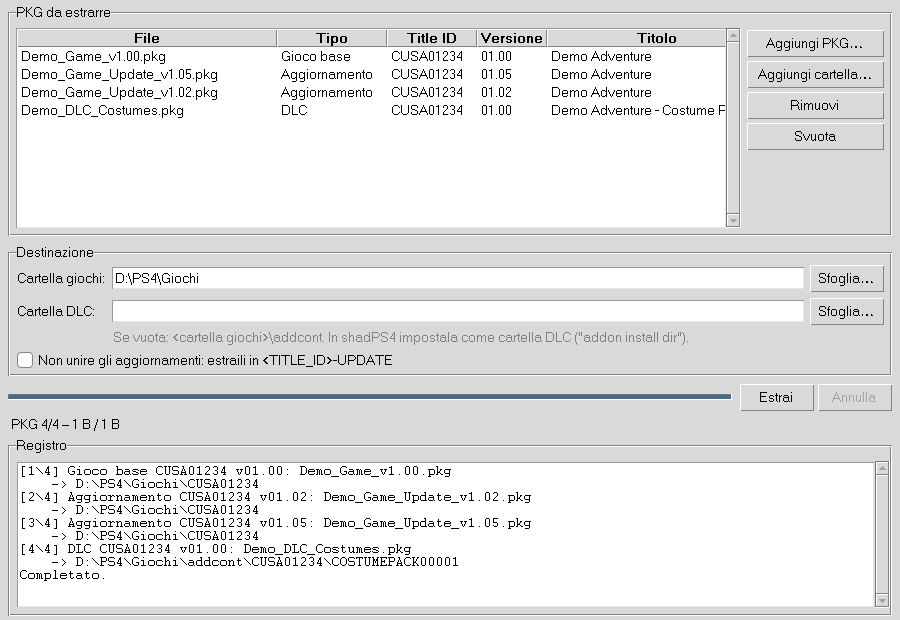

# PKG Free

Programma per Windows che estrae i file **PKG PS4** in una cartella pronta per
l'emulatore [shadPS4](https://github.com/shadps4-emu/shadPS4), unendo
**gioco base + aggiornamenti (patch)** in un'unica cartella aggiornata e
sistemando i **DLC** nella struttura che shadPS4 si aspetta.

> Sono supportati solo i PKG **"fake" (fPKG)**: backup dei propri giochi e
> homebrew firmati con le chiavi di debug pubbliche. I PKG retail scaricati dal
> PlayStation Store sono cifrati con chiavi della console e **non** possono
> essere estratti. Usa il programma solo con contenuti di cui possiedi i diritti.



## Download

Ogni push compila automaticamente gli eseguibili Windows con GitHub Actions
(scheda **Actions** → ultima esecuzione di *Build Windows* → artefatto
`PkgFree-windows`). Creando un tag `v*` (es. `v1.0.0`) viene pubblicata anche
una release con lo zip.

Contenuto:

- `PkgFree.exe`: interfaccia grafica
- `pkgfree-cli.exe`: versione da riga di comando

## Uso (interfaccia grafica)

1. Avvia `PkgFree.exe`.
2. **Aggiungi PKG…** (o **Aggiungi cartella…**) e seleziona insieme gioco base,
   aggiornamenti e DLC, in qualsiasi ordine. Il tipo di ogni PKG viene
   riconosciuto automaticamente dal `param.sfo`.
3. Scegli la **cartella giochi** (e, se vuoi, una **cartella DLC** diversa).
4. Premi **Estrai**.

L'ordine di applicazione è automatico: prima il gioco base, poi gli
aggiornamenti in ordine di versione (`APP_VER`), ognuno sovrascrivendo i file
precedenti, e infine i DLC.

Risultato:

```
<cartella giochi>\CUSA12345\                        gioco + tutti gli aggiornamenti
<cartella DLC>\CUSA12345\<ENTITLEMENT_LABEL>\       un DLC per cartella
```

(Se la cartella DLC è vuota si usa `<cartella giochi>\addcont`.)

In shadPS4:

- aggiungi la *cartella giochi* tra le cartelle dei giochi;
- imposta la *cartella DLC* come cartella dei contenuti aggiuntivi
  (`addon install dir`, oppure `shadPS4.exe --set-addon-folder "<cartella DLC>"`).
  In alternativa scegli direttamente come cartella DLC quella predefinita di
  shadPS4 (`user\addcont`).

Opzione **"Non unire gli aggiornamenti"**: estrae le patch in
`CUSA12345-UPDATE` accanto al gioco, formato che shadPS4 riconosce e
sovrappone al gioco base all'avvio.

## Uso (riga di comando)

```bat
pkgfree-cli info gioco.pkg patch.pkg --files
pkgfree-cli install gioco.pkg patch_1.01.pkg patch_1.05.pkg dlc1.pkg -o D:\PS4\Giochi
pkgfree-cli install patch.pkg -o D:\PS4\Giochi --separate-update
pkgfree-cli install dlc.pkg -o D:\PS4\Giochi --addons C:\shadPS4\user\addcont
```

## Note e limiti

- Le patch **delta** (incrementali) contengono solo le differenze e non
  possono essere unite: viene mostrato un avviso. Le patch fPKG comuni sono
  complete/cumulative e funzionano.
- I DLC che sono solo "chiavi di sblocco" (senza dati) producono una cartella
  con il solo `sce_sys\param.sfo`: è corretto, shadPS4 li riconosce così.
- I file esistenti nella destinazione vengono sovrascritti.
- Velocità indicativa: decine di MB/s (decifratura AES-XTS + decompressione).

## Compilare da sorgente

Serve Python 3.10 o successivo.

```bat
build.bat
```

oppure manualmente:

```bat
pip install -r requirements.txt pyinstaller
python -m unittest discover -s tests
pyinstaller --onefile --windowed --name PkgFree pkgfree_gui.py
pyinstaller --onefile --console --name pkgfree-cli pkgfree_cli.py
```

Senza compilare: `python -m pkgfree` (GUI) oppure `python -m pkgfree install ...`.

## Struttura del codice

| File | Contenuto |
|---|---|
| `pkgfree/pkg.py` | lettura PKG, decifratura PFS (AES-XTS), decompressione PFSC, estrazione |
| `pkgfree/crypto.py` | RSA / AES-CBC / HMAC / XTS |
| `pkgfree/keys.py` | chiavi RSA pubbliche per fPKG |
| `pkgfree/installer.py` | unione gioco + patch + DLC |
| `pkgfree/gui.py`, `pkgfree/cli.py` | interfacce |
| `tests/` | test con PKG sintetici generati al volo |

## Licenza

GPL-2.0-or-later. Il formato e le chiavi derivano dall'estrattore PKG
(GPL-2.0-or-later) storicamente incluso in shadPS4 e da LibOrbisPkg.
